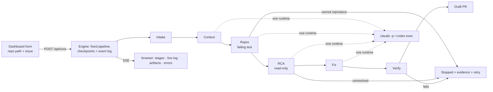

# LYRA — plan

v5 · 2026-11-04 · Rust. Final for the first release; later work is listed in §11 and designed in `docs/RESEARCH.md`.

LYRA is a harness around an off‑the‑shelf coding agent. From a local dashboard you give it a cloned Rust repository and a GitHub issue; it gathers context, writes a failing regression test, finds the root cause, fixes it, verifies, and opens a draft PR. Every step is saved and streamed live.

**Acceptance:** from a localhost dashboard, submit a prepared Rust repository and a GitHub issue, watch the investigation and the agent live, and receive either a draft PR backed by an executed failing‑then‑passing regression test, or a clear stopped result with saved evidence and a retry action.

## 1. Scope of the first release

- One agent runtime per run: **Claude Code or Codex CLI**, chosen in config. Both adapters ship.
- One fixed pipeline: intake → context → repro → RCA → fix → verify → draft PR.
- One active run at a time; runs are kept and browsable.
- Dashboard as the entry point (`lyra serve`): live progress, artifacts, errors, Cancel, Retry from stage.
- Stage checkpoints + append‑only event log; interrupted runs are marked and can be retried.
- Draft PR only, created for the exact commit that passed verification.
- Stops only for genuine failures (cannot reproduce, RCA unresolved, verification failed), always with the evidence and a retry button.

Later (§11): multi‑model RCA, more runtimes (OpenCode/NVIDIA, Copilot, generic command), cost display, automatic resume and fix‑retry loop, GitHub triggers, eval set, web search, container sandbox, non‑Rust repos.

## 2. Flow



```
S0 intake    gh issue view (with comments) → 00-issue.md ; worktree ~/.lyra/runs/<id>/worktree
             branch lyra/issue-<n>-<run-id> from the default branch ; base commit recorded
             CONTRIBUTING / AI-policy excerpts shown on the run page
S1 context   harness collects related issues/PRs, git log -S, blame, cargo metadata, AGENTS.md/CLAUDE.md
             one read-only agent call (Read/Grep/Glob only) → 10-context/summary.json
S2 repro     agent writes a failing test in its own file ; harness runs it ; must fail on the recorded assertion ; formatted, committed
S3 rca       agent in read-only mode, harness supplies history + repro logs → 30-rca/rca.json (supported | unresolved)
S4 fix       agent edits production code ; test file and its registration locked ; commit
S5 verify    cargo build ; the repro test is executed and passes ; cargo test ; cargo fmt --check ; verified SHA recorded
S6 draft PR  body from template + artifacts ; push verified SHA ; find-or-create PR for that exact head
```

## 3. Stages

| Stage | Agent | Outputs in `artifacts/` | Notes |
|---|---|---|---|
| S0 Intake | – | `00-issue.md/json`, `policy.md` (if the repo has CONTRIBUTING / AI‑policy text), `run.json.base_commit` | bad repo path or `gh` unauthenticated → failed with the message |
| S1 Context | read‑only, no commands | `10-context/related.json`, `git-history.md`, `repo.json`, `instructions.md`, `summary.json` (candidate files, crate, test command) | collectors are best‑effort; agent failure → failed (retryable) |
| S2 Repro | edit | new test file in the repo + `20-repro/repro.json` `{crate, test_file, test_name, command, expected, observed}`, `output.txt` | 3.1 |
| S3 RCA | read‑only, no commands | `30-rca/rca.json` | 3.2 |
| S4 Fix | edit | `40-fix/fix.diff`, `notes.md`, `scope.json` | 3.3 |
| S5 Verify | – | `50-verify/build.txt`, `repro-after.txt`, `tests.txt`, `fmt.txt`, `result.json`, `run.json.verified_commit` | 3.4 |
| S6 Draft PR | – | `60-pr/body.md`, `url.txt` | 3.5 |

### 3.1 Repro: a separate test file that fails on the recorded assertion

- The test lives in **its own file**, where Cargo discovers it: `<crate>/tests/issue_<n>.rs` (integration test), or for private APIs a new module file `src/<module>/issue_<n>_tests.rs` registered with one added line `#[cfg(test)] mod issue_<n>_tests;`. Nothing is written inside existing source files beyond that line.
- Allowed changes in S2: the new test file, fixtures, the registration line, added `[dev-dependencies]`. Any other change → S2 failed (retryable, diff shown).
- `repro.json.expected` records what failure proves the bug (assertion message or panic text). The harness runs `cargo test -p <crate> <test_name> -- --exact` and requires: it compiles, exactly that test ran, result `FAILED`, and the output contains `expected`. A compile error, a missing dependency, "0 tests run" or an unrelated panic is not a reproduction → failed (retryable).
- The agent reporting it cannot reproduce → stopped (`not_reproduced`), its notes saved, Retry available.
- The harness formats the test (`rustfmt`) and commits it (`test: failing repro for #<n>`). That commit is the S2 checkpoint and the frozen form of the test.

### 3.2 RCA: read‑only, evidence supplied by the harness, may be unresolved

- The agent gets only file reading and search (Claude: `--tools "Read,Grep,Glob"`; Codex: `--sandbox read-only`). It does not run commands; the harness passes in what it would have run: `git log`/`blame` for the candidate files, `cargo metadata`, and the repro output. This keeps the stage read‑only without extra sandboxing (Bash could write files and `cargo` executes build scripts).
- After the call: `git status --porcelain` must be empty and HEAD unchanged; otherwise failed (change detection).
- Output through the runtime's structured output (Claude `--json-schema`, Codex `--output-schema -o`):

```json
{ "result": "supported | unresolved",
  "culprits": [{"file": "src/parser.rs", "symbol": "parse_header", "lines": [120, 145]}],
  "mechanism": "why the code produces the observed failure",
  "evidence": ["repro output line …", "file:line …"],
  "introduced_by": {"commit": "abc123"},
  "fix_sketch": "what to change; what must not change",
  "confidence": 0.0 }
```

`introduced_by` is optional. `unresolved` → stopped with the RCA saved and Retry available.

### 3.3 Fix: production code changes, test locked

- Prompt: make the locked test pass with the smallest change; do not touch the test file; no refactors; follow `instructions.md`.
- The harness rejects the fix (retryable, diff shown) if: the repro test file changed from its frozen form; its registration line changed; `#[ignore]`/`cfg` gates were added to it; `Cargo.toml` `[[test]]`, `autotests`, `[dev-dependencies]` or `.cargo/config*` changed; the recorded test command changed. Changes to the production file the test exercises are expected.
- `scope.json` records files and lines changed and any other test files touched; it goes into the PR body.
- Commit `fix: <issue title> (#<n>)` → S4 checkpoint.

### 3.4 Verify: the intended test runs and passes

1. `cargo build --workspace`
2. `cargo test -p <crate> <test_name> -- --exact` → output contains `test <test_name> ... ok` and `1 passed`; filtered, ignored or missing → fail.
3. `cargo test --workspace`
4. `cargo fmt --all -- --check`

Pass → `verified_commit = HEAD` recorded. Fail → stopped (`verify_failed`) with the logs; the run page offers **Retry from Fix**, which reruns S4 with the verify output attached.

### 3.5 Draft PR for the verified commit

- Push `verified_commit` to `lyra/issue-<n>-<run-id>` on the push remote.
- Find an existing PR with `gh pr list --repo <target> --head <owner>:<branch> --base <default>`; it counts as done only if its head SHA equals `verified_commit`; otherwise create one with `gh pr create --draft --repo <target> --head <owner>:<branch> --base <default> --title … --body-file 60-pr/body.md`.
- Body from a template filled with artifacts: issue link, how to run the repro test, RCA mechanism and culprit, what changed (`scope.json`), verify results, and a disclosure line naming LYRA and the model. No model call.
- Fork‑aware: `origin` is a fork → push there, PR against upstream; no push rights → stop with the `gh repo fork` command.
- If `policy.md` exists, the run page requires the "I read the repository's contribution policy" checkbox before pushing.
- Commits use the operator's git identity; no AI co‑author trailers.

## 4. Runtime adapters

One trait, two implementations. Prompts are markdown templates; the stage passes the mode, the schema and the artifact paths.

```rust
#[async_trait]
pub trait Agent: Send + Sync {
    async fn run(&self, task: AgentTask, events: EventSink) -> Result<AgentOutput>;
}
pub struct AgentTask { cwd: PathBuf, artifacts: PathBuf, prompt: String, mode: Mode /* ReadOnly | Edit */, schema: Option<Value> }
pub struct AgentOutput { text: String, structured: Option<Value>, transcript: PathBuf }
pub enum AgentEvent { Text(String), ToolCall { name: String, summary: String }, ToolResult { ok: bool }, FileChanged(PathBuf), Finished, Error(String) }
```

| | Claude Code (2.1.317 installed) | Codex CLI (0.166.0 installed) |
|---|---|---|
| Read‑only (S1, S3) | `claude -p "<prompt>" --output-format stream-json --verbose --tools "Read,Grep,Glob" --json-schema <schema> --add-dir <artifacts>` | `codex exec --json -C <worktree> --sandbox read-only --output-schema <schema> -o <artifacts>/…json --ephemeral "<prompt>"` |
| Edit (S2, S4) | `claude -p "<prompt>" --output-format stream-json --verbose --tools default --allowedTools "Read,Grep,Glob,Edit,Write,Bash(cargo *),Bash(git diff *),Bash(git log *)" --permission-mode acceptEdits --add-dir <artifacts>` | `codex exec --json -C <worktree> --sandbox workspace-write --ephemeral "<prompt>"` |
| Auth profiles | `auth = "api_key"`: add `--bare`, needs `ANTHROPIC_API_KEY`. `auth = "login"`: no `--bare` (uses your `claude` login), add `--setting-sources user --disallowedTools "mcp__*"` so the target repo's project settings and MCP servers are not loaded | `CODEX_API_KEY` or saved `codex` login |
| Repo hooks/MCP | `--bare` skips them; in `login` mode the flags above exclude project settings and MCP (`CLAUDE.md` still loads) | project `.codex/` config loads (providers ignored); hooks need explicit trust and LYRA never passes bypass flags; `AGENTS.md` loads natively |
| Live events | `assistant`/`user`/`result` lines; `structured_output` on the `result` line; the `StructuredOutput` tool call is hidden in the live log | `item.*` lines (`agent_message`, `command_execution`, `file_change`), `turn.completed` / `turn.failed` |
| Failure signals | `result.subtype != success`, `permission_denials`, missing `structured_output` | `turn.failed`, missing `-o` file |

`--allowedTools` only grants permission; `--tools` / `--disallowedTools` restrict. Windows: resolve `claude.cmd` / `codex.cmd` with `which`, spawn through `cmd /C`, kill the process tree on cancel.

## 5. State, retries, recovery

- `run.json`: `{ status: queued|running|stopped|failed|done|interrupted|cancelled, stage, base_commit, checkpoints: {s2, s4}, verified_commit, attempts: [{stage, n, input_commit, result}] }`, rewritten on every transition.
- `events.jsonl`: append‑only; every transition, agent event, artifact write and error. The dashboard streams it.
- Stage statuses: `pending → running → done | failed | stopped`.
- **Retry from stage N** (button): outputs of stages ≥ N move to `attempts/<n>/`; the worktree is restored to the checkpoint before N with `git reset --hard <checkpoint>` **and** `git clean -fd` (files created by the previous attempt are removed); `verified_commit` is cleared if N ≤ S5; N runs again. Attempts record the input commit, so a stale result can never describe an older patch.
- **Cancel**: kills the child process tree, marks `cancelled`; Retry stays available.
- **Interrupted**: on `lyra serve` start, any run left `running` is marked `interrupted` at its stage; Retry from that stage.
- **Hang guard**: `run.timeout_minutes` (default 30) per agent call or verify command, so a stuck process ends as a failed stage instead of a hung run.

## 6. Dashboard

`lyra serve` → `http://127.0.0.1:7700`, opens the browser.

- **New run**: repo path (checked: exists, git repo, `cargo metadata` ok), issue URL / `#n` / pasted text, runtime (from config), Run.
- **Run page**: stages with status and duration; live log of the agent (tool calls, text, file changes); artifact viewer; error panel (stage, attempt, message, transcript link); buttons Cancel, Retry from stage, Open PR; policy checkbox when `policy.md` exists.
- **Runs list**: status, issue, PR link.
- Tech: `axum` + `maud` templates + htmx (vendored) + SSE; single binary, no JS build. API: `POST /api/runs`, `GET /api/runs`, `GET /api/runs/:id`, `GET /api/runs/:id/events` (SSE), `POST /api/runs/:id/cancel`, `POST /api/runs/:id/retry/:stage`, `GET /api/runs/:id/artifacts/*path`, `GET /api/doctor`.

## 7. Storage and config

```
~/.lyra/
  config.toml
  runs/<run-id>/            <owner>-<repo>-<issue>-<timestamp>
    run.json  events.jsonl
    worktree/               branch lyra/issue-<n>-<run-id>
    artifacts/              00-issue.md  10-context/  20-repro/  30-rca/  40-fix/  50-verify/  60-pr/  transcripts/
    attempts/               superseded stage outputs after a retry
```

```toml
[run]
provider = "claude"            # "claude" | "codex"
timeout_minutes = 30           # hang guard per agent call / verify command

[server]
bind = "127.0.0.1:7700"

[providers.claude]
auth = "api_key"               # "api_key" | "login"
model = "opus"

[providers.codex]
model = "gpt-5.5-codex"

[verify]                       # <repo>/lyra.toml can override
build = "cargo build --workspace"
test  = "cargo test --workspace"
fmt   = "cargo fmt --all -- --check"
```

`lyra doctor` (and `GET /api/doctor`): runtime on PATH + version, auth works (one cheap prompt), `gh auth status`, cargo present.

## 8. Code layout

```
src/
  main.rs            serve | doctor
  config.rs
  engine.rs          run state, fixed stage order, retry-from-stage, cancel, hang guard
  events.rs          Event enum, jsonl writer, broadcast
  stages/            intake.rs context.rs repro.rs rca.rs fix.rs verify.rs pr.rs
  guards.rs          repro diff rules, expected-assertion match, test lock, verify output parsing
  providers/         mod.rs (trait) claude.rs codex.rs
  web/               server.rs api.rs sse.rs views.rs static/
  git.rs github.rs proc.rs artifacts.rs doctor.rs
  prompts/*.md  schemas/*.json
tests/fixtures/      recorded stream-json / codex --json samples; guard and reducer tests
```

Crates: `tokio`, `axum`, `maud`, `clap`, `serde`, `serde_json`, `toml`, `anyhow`, `thiserror`, `tracing`, `async-trait`, `tokio-util`, `jsonschema`, `which`, `minijinja`. No database, no HTTP model client.

## 9. Build order

1. **Skeleton**: `lyra serve`, new‑run form, run dir, `run.json` + `events.jsonl`, Claude adapter, live log over SSE, Cancel. Check: a "list the crates in this workspace" run shows live tool calls and finishes.
2. **Complete path with its guards**, on a seeded bug in a scratch crate: S0 → S6 including the repro rules (separate file, expected assertion), test lock, verify parsing, verified‑SHA PR. Check: a draft PR with the failing‑then‑passing test, submitted from the browser, whose head is the verified commit.
3. **Codex adapter**, recorded fixtures for both runtimes, `doctor`.
4. **Retries and recovery**: typed errors on the run page, Retry from stage with checkpoint restore (`reset --hard` + `clean -fd`) and invalidation, interrupted marking.
5. **Exercise**: the seeded bug, one unreproducible issue, one real issue in a Rust OSS repo. README.

## 10. Decisions

| # | Decision |
|---|---|
| D1 | One runtime per run (Claude Code or Codex); no model API client; multi‑model RCA later, chosen with data (RESEARCH.md §1) |
| D2 | The repro test is the regression test: its own file, written before the fix, discoverable by Cargo, fails on the recorded assertion, frozen and locked during the fix, executed and passing in verify |
| D3 | Read‑only stages get file reading and search only; the harness supplies command output; the git check is change detection |
| D4 | Structured outputs through the runtimes' own schema flags |
| D5 | Fixed pipeline, stage checkpoints, append‑only event log; retry‑from‑stage restores a clean checkpoint and invalidates later stages; no skip |
| D6 | No cost or time budgets; one hang‑guard timeout and a Cancel button |
| D7 | Dashboard is the entry point; `axum` + `maud` + htmx + SSE in one binary |
| D8 | Unique branch per run; the PR is for the exact verified commit; draft only; template body with disclosure; policy text acknowledged by the user; operator git identity; no AI co‑author trailers |
| D9 | Follow the selected repo's contribution rules as written; no blanket skip rules |

## 11. After the first release

In rough order: multi‑model RCA with blind parallel runs and adjudication (RESEARCH.md §1) · OpenCode (NVIDIA / any OpenAI‑compatible key), Copilot CLI, generic command adapter · cost display where the runtime reports it · automatic fix‑retry loop · automatic resume of interrupted runs · GitHub label/comment trigger and pre‑work issue comment · eval set on closed issues with known fixes · web search in context · container sandbox · non‑Rust repos · richer UI (Dioxus) or distributed execution (Temporal / Restate) if ever needed.
