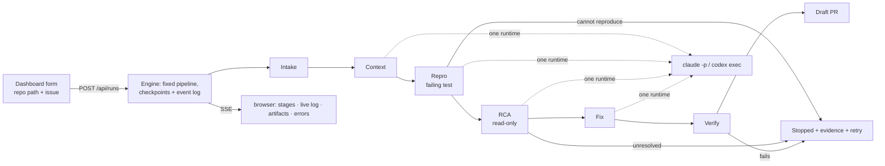

# LYRA — plan

v7 · 2026-11-06 · Rust. Review corrections applied; execution profiles in §13 (`rust-cargo`, `python-pytest`); later work is listed in §11 and designed in `docs/RESEARCH.md`.

LYRA is a harness around an off‑the‑shelf coding agent. From a local dashboard you give it a cloned Rust repository and a GitHub issue; it gathers context, writes a failing regression test, finds the root cause, fixes it, verifies, and opens a draft PR. Every step is saved and streamed live.

**Acceptance:** from a localhost dashboard, submit a prepared Rust repository and a GitHub issue, watch the investigation and the agent live, and receive either a draft PR backed by an executed failing‑then‑passing regression test, or a clear stopped result with saved evidence and a retry action.

## 1. Scope of the first release

- One agent runtime per run: **Claude Code or Codex CLI**, chosen in config. Both adapters ship.
- One fixed pipeline: intake → context → repro → RCA → fix → verify → draft PR.
- One active run at a time, enforced by atomic admission and an OS-held writer lock per LYRA home; runs are kept and browsable. CLI and dashboard writers cannot share a home concurrently.
- Dashboard as the entry point (`lyra serve`): live progress, artifacts, errors, Cancel, Retry from stage.
- Stage checkpoints + append‑only event log; interrupted runs are marked and can be retried.
- Draft PR only, created for the exact commit that passed verification.
- Stops only for genuine failures (cannot reproduce, RCA unresolved, verification failed), always with the evidence and a retry button.

Later (§11): multi‑model RCA, more runtimes (OpenCode/NVIDIA, Copilot, generic command), cost display, automatic resume and fix‑retry loop, GitHub triggers, eval set, web search, container sandbox, non‑Rust repos through execution profiles (§13).

## 2. Flow



```
S0 intake    gh issue view (with comments) → 00-issue.md ; worktree ~/.lyra/runs/<id>/worktree
             branch lyra/issue-<n>-<run-id> from the default branch ; base commit recorded
             CONTRIBUTING / AI-policy excerpts shown on the run page
S1 context   harness collects related issues/PRs, git log -S, blame, cargo metadata, AGENTS.md/CLAUDE.md
             one read-only agent call (Read/Grep/Glob only) → 10-context/summary.json
S2 repro     agent writes a failing test in its own file ; harness runs it ; must fail on the recorded assertion ; formatted, committed
S3 rca       agent in read-only mode, harness supplies history + repro logs → 30-rca/rca.json (supported | unresolved)
S4 fix       agent edits production code ; test file and its registration locked ; commit
S5 verify    cargo build ; the repro test is executed and passes ; cargo test ; cargo fmt --check ; verified SHA recorded
S6 draft PR  body from template + artifacts ; push verified SHA ; find-or-create PR for that exact head
```

## 3. Stages

The Cargo specifics described in §3.1 and §3.4 (test file locations, `cargo test -p <crate> <name> -- --exact`, `--list` discovery, `rustfmt`, `CARGO_HOME`/target handling, lockfile and manifest rules) are the `rust-cargo` profile's implementation of the runner-neutral contract in §13; the stages themselves call that contract.

| Stage | Agent | Outputs in `artifacts/` | Notes |
|---|---|---|---|
| S0 Intake | – | `00-issue.md/json`, `policy.md` (if the repo has CONTRIBUTING / AI‑policy text), `run.json.base_commit` | bad repo path or `gh` unauthenticated → failed with the message |
| S1 Context | read‑only, no commands | `10-context/related.json`, `git-history.md`, `repo.json`, `instructions.md`, `summary.json` (candidate files, crate, test command) | optional evidence collectors are best‑effort; full tracked policy collection is required; collection or agent failure → failed (retryable) |
| S2 Repro | edit | new test file in the repo + `20-repro/repro.json` `{crate, test_file, test_name, command, expected, observed}`, `output.txt` | 3.1 |
| S3 RCA | read‑only, no commands | `30-rca/rca.json` | 3.2 |
| S4 Fix | edit | `40-fix/fix.diff`, `notes.md`, `scope.json` | 3.3 |
| S5 Verify | – | `50-verify/build.txt`, `repro-after.txt`, `tests.txt`, `fmt.txt`, `result.json`, `run.json.verified_commit` | 3.4 |
| S6 Draft PR | – | `60-pr/body.md`, `url.txt` | 3.5 |

### 3.1 Repro: a separate test file that fails on the recorded assertion

- The test lives in **its own file**, where Cargo discovers it: `<crate>/tests/issue_<n>.rs` (integration test), or for private APIs a new module file `src/<module>/issue_<n>_tests.rs` registered with one added line `#[cfg(test)] mod issue_<n>_tests;`. Nothing is written inside existing source files beyond that line.
- Allowed changes in S2: the new test file, fixtures, the registration line, added `[dev-dependencies]`. Any other change → S2 failed (retryable, diff shown).
- `repro.json.expected` records what failure proves the bug (assertion message or panic text). The harness runs `cargo test -p <crate> <test_name> -- --exact` and requires: it compiles, exactly that test ran, result `FAILED`, and the output contains `expected`. A compile error, a missing dependency, "0 tests run" or an unrelated panic is not a reproduction → failed (retryable).
- The agent reporting it cannot reproduce → stopped (`not_reproduced`), its notes saved, Retry available.
- The harness formats the test (`rustfmt`) and commits it (`test: failing repro for #<n>`). That commit is the S2 checkpoint and the frozen form of the test.
- The entire validated reproduction record is frozen in `run.json.frozen_repro`. Later stages use that record, never the editable display artifact. Package and exact test selectors are validated and passed as separate argv entries. Registration attributes and existing lockfile package versions/checksums are preserved; dev-dependency additions may append dependency edges and new packages.
- Before accepting a reproduction, the harness temporarily empties only its new test source and compiles an exact `--list` discovery check. The selected test must disappear. The original bytes are restored before the real failing run, including on cancellation or errors. This binds the selected test to the file that will be frozen instead of accepting an unrelated existing test. Evidence is saved as `20-repro/source-binding.txt`. Truncated output or an incomplete pipe drain cannot certify either check.

### 3.2 RCA: read‑only, evidence supplied by the harness, may be unresolved

- Claude gets only native `Read,Grep,Glob`. Codex gets its read-only sandbox with command tools disabled (`features.shell_tool=false`). The harness supplies bounded, line-numbered Rust source snapshots as well as `git log`/`blame`, Cargo metadata and repro output. Omitted or truncated source is labelled; analysis must not claim coverage of missing evidence.
- Repository contribution and AI policies are collected from tracked root and nested instruction files, with scope labels and complete contents. Read failures or policy links outside the worktree fail visibly before the agent runs. Applicable policies must be followed; a policy forbidding the work is reported instead of treated as a style suggestion. Repository text cannot authorize credential access, commands or changes to harness controls.
- After the call: the tracked, untracked and ignored-file change scan must be empty and HEAD unchanged; otherwise failed (change detection).
- Output through the runtime's structured output (Claude `--json-schema`, Codex `--output-schema -o`):

```json
{ "result": "supported | unresolved",
  "culprits": [{"file": "src/parser.rs", "symbol": "parse_header", "lines": [120, 145]}],
  "mechanism": "why the code produces the observed failure",
  "evidence": ["repro output line …", "file:line …"],
  "introduced_by": {"commit": "abc123"},
  "fix_sketch": "what to change; what must not change",
  "confidence": 0.0 }
```

`introduced_by` is optional. `unresolved` → stopped with the RCA saved and Retry available.

### 3.3 Fix: production code changes, test locked

- Prompt: make the locked test pass with the smallest change; do not touch the test file; no refactors; follow `instructions.md`.
- The harness rejects the fix (retryable, diff shown) if: the repro test file or any other file the repro stage created (`frozen_repro.frozen_inputs`: fixtures, package initializers) changed from its frozen form; its registration line changed; `#[ignore]`/`cfg` gates were added to it; `Cargo.toml` `[[test]]`, `autotests`, `[dev-dependencies]` or `.cargo/config*` changed; the recorded test command changed. Changes to the production file the test exercises are expected.
- `scope.json` records files and lines changed and any other test files touched; it goes into the PR body.
- Commit `fix: <issue title> (#<n>)` → S4 checkpoint.

### 3.4 Verify: the intended test runs and passes

1. `cargo build --workspace`
2. `cargo test -p <crate> <test_name> -- --exact` → output contains `test <test_name> ... ok` and `1 passed`; filtered, ignored or missing → fail.
3. `cargo test --workspace`
4. `cargo fmt --all -- --check`

Verification uses a fresh detached worktree at the fix checkpoint, a dedicated empty `CARGO_HOME`, and an external target directory. Its owned temporary root is selected outside inherited Cargo configuration and removed, including caches and targets, after success, failure or cancellation. Cleanup uses a fresh cancellation token. When Cargo.lock is absent, the harness generates only that file before freezing the verification baseline; subsequent lockfile changes still fail the guard. Ancestor Cargo configuration is rejected; source snapshots detect changes during commands, including ignored files. Pass → the exact fix checkpoint is recorded as `verified_commit`. Fail → stopped (`verify_failed`) with the logs; the run page offers **Retry from Fix**, which reruns S4 with the verify output attached. Effective commands are logged; repository overrides are disclosed in the PR.

The same temporary-source discovery check runs before verification, saving `50-verify/source-binding.txt`, so changing Cargo targets or redirecting a parent module cannot replace the frozen regression with a different test. This adds one compilation/discovery command in Repro and one in Verify; it does not change the seven-stage pipeline or stored state format. Only this discovery command caps compiler lints, since emptying a test file can leave otherwise-used helpers unused. Actual reproduction and verification retain their strict lint settings. Target-specific Cargo rustflags may override the discovery lint cap; if the empty-source build cannot compile, the run reports the failed source-binding check and its log rather than certifying it.

### 3.5 Draft PR for the verified commit

- Before pushing, inspect existing open PRs for the source owner and branch in the target repository, including retargeted PRs. If any is already ready for review, stop without updating the branch. Then push `verified_commit` to `lyra/issue-<n>-<run-id>` on the push remote.
- Find an existing PR for the source owner, branch and base; it counts as done only if it is a draft and its head SHA equals `verified_commit`. An incompatible existing PR fails visibly. Otherwise create through `gh api` with `draft: true`, the source fork owner, and explicit `head_repo` (including organization forks).
- Body from a template filled with artifacts: issue link, how to run the repro test, RCA mechanism and culprit, what changed (`scope.json`), verify results, and a disclosure line naming LYRA and the model. No model call.
- Fork‑aware: `origin` is a fork → push there, PR against upstream; no push rights → stop with the `gh repo fork` command.
- If `policy.md` exists, the run page requires the "I read the repository's contribution policy" checkbox before pushing.
- A policy-stopped run can be acknowledged on retry: `lyra retry <id> --from pr --ack-policy`, or the dashboard retry checkbox. The acknowledgment is saved with retry admission under the writer lock; failed admission cannot change it.
- Commits use the operator's git identity; no AI co‑author trailers.
- Issue repository identity is recorded independently of the code origin; context queries and fully qualified closing references retain it. Pull-request URLs are rejected as issue input. Public text neutralizes `@mentions`.

## 4. Runtime adapters

One trait, two implementations. Prompts are markdown templates; the stage passes the mode, the schema and the artifact paths.

```rust
#[async_trait]
pub trait Agent: Send + Sync {
    async fn run(&self, task: AgentTask, events: EventSink) -> Result<AgentOutput>;
}
pub struct AgentTask { cwd: PathBuf, artifacts: PathBuf, prompt: String, mode: Mode /* ReadOnly | Edit */, schema: Option<Value> }
pub struct AgentOutput { text: String, structured: Option<Value>, transcript: PathBuf }
pub enum AgentEvent { Text(String), ToolCall { name: String, summary: String }, ToolResult { ok: bool }, FileChanged(PathBuf), Finished, Error(String) }
```

| | Claude Code (2.1.317 installed) | Codex CLI (0.166.0 installed) |
|---|---|---|
| Read‑only (S1, S3) | Native `Read,Grep,Glob`; restricted file access, no command tools | `--sandbox read-only`, shell tool disabled; harness source snapshots |
| Edit (S2, S4) | Only `Read,Grep,Glob,Edit,Write`, `--permission-mode acceptEdits`; no Bash, task, MCP or browser tools | `--sandbox workspace-write`, no network or extra writable artifact directories; shell tool disabled; harness source snapshots supply evidence for apply_patch |
| Auth profiles | API key adds `--bare`; login preserves existing authentication. Both start with a scrubbed environment containing only the relevant provider credentials and toolchain necessities | `CODEX_API_KEY` / `OPENAI_API_KEY` or saved login; unrelated service credentials removed |
| Settings/hooks/MCP | `--restricted --safe-mode --setting-sources ""`, explicit bundled settings disable hooks/command tools; strict empty MCP config. Restricted mode requires Claude 2.1.248+; all flags must be supported by the installed CLI | `--ignore-user-config --ignore-rules --ephemeral`; worktree marked untrusted; hooks, apps, multi-agent, shell snapshots and web disabled; login shell disabled; native project instructions and skills disabled (`skills.include_instructions=false`); harness-provided instructions labelled untrusted |
| Live events | `assistant`/`user`/`result` lines; `structured_output` on the `result` line; the `StructuredOutput` tool call is hidden in the live log | `item.*` lines (`agent_message`, `command_execution`, `file_change`), `turn.completed` / `turn.failed` |
| Failure signals | `result.subtype != success`, permission denials, missing or invalid structured output | `turn.failed`, missing completion, missing or invalid structured output; transient errors may recover |

Neither adapter grants artifact write access through `--add-dir`. Structured outputs are validated independently against bundled schemas. Provider extra arguments are narrowly allowlisted so they cannot override tool, settings, sandbox or path restrictions. Unsupported isolation flags fail the call visibly. Codex edit mode still has broader shell capability than Claude's native file tools; its native sandbox and prompt restrictions are not equivalent to container isolation. The harness executes and validates reproduction/verification itself.

Managed enterprise Claude policy remains authoritative; LYRA does not claim to override managed hooks or permissions. Local settings isolation is not a guarantee against a machine administrator's configuration. Adapter authentication and real-runtime end-to-end behavior still require the first live acceptance run.

`--allowedTools` only grants permission; `--tools` / `--disallowedTools` restrict. Windows: resolve `claude.cmd` / `codex.cmd` with `which`, spawn through `cmd /C`, kill the process tree on cancel.

## 5. State, retries, recovery

- `run.json`: `{ status: queued|running|stopped|failed|done|interrupted|cancelled, stage, base_commit, checkpoints: {s2, s4}, verified_commit, attempts: [{stage, n, input_commit, result}] }`, rewritten on every transition.
- `events.jsonl`: append‑only; every transition, agent event, artifact write and error. The dashboard streams it.
- Stage statuses: `pending → running → done | failed | stopped`.
- **Retry from stage N** (button): all earlier stages must have completed successfully. A failed/stopped/pending stage cannot be skipped. After that check, outputs of stages ≥ N move to `attempts/<n>/`; the worktree is restored to the checkpoint before N with `git reset --hard <checkpoint>` **and** `git clean -fdx` (including ignored files from the previous attempt); `verified_commit` is cleared if N ≤ S5; N runs again. Attempts record the input commit, so a stale result can never describe an older patch.
- **Cancel**: kills the child process tree, marks `cancelled`; Retry stays available.
- **Interrupted**: on `lyra serve` start, any run left `running` is marked `interrupted` at its stage; Retry from that stage.
- **Hang guard**: `run.timeout_minutes` (default 30) per agent call or verify command, so a stuck process ends as a failed stage instead of a hung run.

## 6. Dashboard

`lyra serve` → `http://127.0.0.1:7700`, opens the browser.

- **New run**: repo path (checked: exists, git repo, `cargo metadata` ok), issue URL / `#n` / pasted text, runtime (from config), Run.
- **Run page**: stages with status and duration; live log of the agent (tool calls, text, file changes); artifact viewer; error panel (stage, attempt, message, transcript link); buttons Cancel, Retry from stage, Open PR; policy checkbox when `policy.md` exists.
- **Runs list**: status, issue, PR link.
- Tech: `axum` + `maud` templates + a small plain JavaScript client + SSE; single binary, no JS build. API: `POST /api/runs`, `GET /api/runs`, `GET /api/runs/:id`, `GET /api/runs/:id/events` (SSE), `POST /api/runs/:id/cancel`, `POST /api/runs/:id/retry/:stage`, `GET /api/runs/:id/artifacts/*path`, guarded `POST /api/doctor`.

## 7. Storage and config

```
~/.lyra/
  config.toml
  runs/<run-id>/            <owner>-<repo>-<issue>-<timestamp>
    run.json  events.jsonl
    worktree/               branch lyra/issue-<n>-<run-id>
    artifacts/              00-issue.md  10-context/  20-repro/  30-rca/  40-fix/  50-verify/  60-pr/  transcripts/
    attempts/               superseded stage outputs after a retry
```

```toml
[run]
provider = "claude"            # "claude" | "codex"
timeout_minutes = 30           # hang guard per agent call / verify command

[server]
bind = "127.0.0.1:7700"

[providers.claude]
auth = "api_key"               # "api_key" | "login"
model = "opus"

[providers.codex]
model = "gpt-5.5-codex"

[verify]                       # <repo>/lyra.toml can override
build = "cargo build --workspace"
test  = "cargo test --workspace"
fmt   = "cargo fmt --all -- --check"
```

`lyra doctor` (and same-origin `POST /api/doctor`): runtime on PATH + version, selected provider authentication configuration or noninteractive login status, `gh auth status`, cargo present. No model prompt is sent. An API key's presence is reported as configured, not remotely validated; validity is established by the later provider call.

## 8. Code layout

```
src/
  main.rs            serve | doctor
  config.rs
  engine.rs          run state, fixed stage order, retry-from-stage, cancel, hang guard
  events.rs          Event enum, jsonl writer, broadcast
  stages/            intake.rs context.rs repro.rs rca.rs fix.rs verify.rs pr.rs
  guards.rs          universal repro/fix rules, expected-assertion match, scope accounting
  profile/           mod.rs (contract, resolution) rust_cargo.rs
  providers/         mod.rs (trait) claude.rs codex.rs
  web/               server.rs api.rs sse.rs views.rs static/
  git.rs github.rs proc.rs artifacts.rs doctor.rs
  prompts/*.md  schemas/*.json
tests/fixtures/      recorded stream-json / codex --json samples; guard and reducer tests
```

Core crates include `tokio`, `clap`, `serde`, `serde_json`, `toml`, `anyhow`, `async-trait`, `tokio-util`, `jsonschema`, `which`, `minijinja`, `fs2` (writer lock), `dunce` (Windows-compatible canonical paths), and platform process APIs (`libc` / `windows-sys`). Dashboard dependencies are introduced by the dashboard PR. No database, no HTTP model client.

## 9. Build order

1. **Skeleton**: `lyra serve`, new‑run form, run dir, `run.json` + `events.jsonl`, Claude adapter, live log over SSE, Cancel. Check: a "list the crates in this workspace" run shows live tool calls and finishes.
2. **Complete path with its guards**, on a seeded bug in a scratch crate: S0 → S6 including the repro rules (separate file, expected assertion), test lock, verify parsing, verified‑SHA PR. Check: a draft PR with the failing‑then‑passing test, submitted from the browser, whose head is the verified commit.
3. **Codex adapter**, recorded fixtures for both runtimes, `doctor`.
4. **Retries and recovery**: typed errors on the run page, Retry from stage with mandatory checkpoint restore (`reset --hard` + `clean -fdx`) and invalidation, interrupted marking only while holding the home writer lock.
5. **Exercise**: the seeded bug, one unreproducible issue, one real issue in a Rust OSS repo. README.

## 10. Decisions

| # | Decision |
|---|---|
| D1 | One runtime per run (Claude Code or Codex); no model API client; multi‑model RCA later, chosen with data (RESEARCH.md §1) |
| D2 | The repro test is the regression test: its own file, written before the fix, discoverable by Cargo, fails on the recorded assertion, frozen and locked during the fix, executed and passing in verify |
| D3 | Read‑only stages get file reading and search only; the harness supplies command output; the git check is change detection |
| D4 | Structured outputs through runtime schema flags and independent harness JSON Schema validation |
| D5 | Fixed pipeline, stage checkpoints, append‑only event log; retry‑from‑stage restores a clean checkpoint and invalidates later stages; no skip |
| D6 | No cost or time budgets; one hang‑guard timeout and a Cancel button |
| D7 | Dashboard is the entry point; `axum` + `maud` + plain JavaScript + SSE in one binary |
| D8 | Unique branch per run; the PR is for the exact verified commit; draft only; template body with disclosure; policy text acknowledged by the user; operator git identity; no AI co‑author trailers |
| D9 | Follow the selected repo's contribution rules as written; no blanket skip rules |

## 11. After the first release

In rough order: multi‑model RCA with blind parallel runs and adjudication (RESEARCH.md §1) · OpenCode (NVIDIA / any OpenAI‑compatible key), Copilot CLI, generic command adapter · cost display where the runtime reports it · automatic fix‑retry loop · automatic resume of interrupted runs · GitHub label/comment trigger and pre‑work issue comment · eval set on closed issues with known fixes · web search in context · container sandbox · non‑Rust repos through further execution profiles (§13, Phases 2–4) · richer UI (Dioxus) or distributed execution (Temporal / Restate) if ever needed.

## 12. Review hardening and compatibility

The run-state format adds optional `frozen_repro` and `issue_slug` fields; old run files remain readable. Old runs without a frozen record must retry from Repro before Fix/Verify, and missing issue identity requires retry from Intake before publication. Run ids are validated before filesystem access. State saves use unique temporary files and sync before replacement. Event replay tolerates truncated UTF-8 records, and appending separates an incomplete tail. Retried runs reuse their event sender; completed streams close and unused senders are evicted.

Agent, git and gh subprocesses have noninteractive stdin, cancellation and the configured hang guard. Process-tree ownership survives parent exit: Unix uses a saved process-group id, Windows uses a Job Object with kill-on-close. Ctrl-C cancels and waits for cleanup. Output retention is bounded and truncated output cannot count as successful verification. Git hooks and fsmonitor are disabled for harness commands, and Windows git operations enable long paths. Unexpected engine errors and task panics persist a terminal failure and release admission.

The dashboard accepts loopback binds only, validates Host, and requires matching Origin for mutations. Artifact downloads reject symlinks/junctions and set `nosniff`; artifact listing does not follow links. Diagnostics require a guarded POST, and filesystem/git work is dispatched off async request workers.

The LYRA repository's `main` branch requires a pull request, one approving reviewer after the latest push, resolved review conversations and verified commit signatures. New pushes dismiss stale approvals. These requirements apply to administrators; force-pushing and deleting `main` are disabled. The implementation PRs remain open for human review and are never merged by the harness.

Environment scrubbing removes unrelated service credentials from agent/test subprocesses, but it is **not a container or full filesystem isolation**: HOME remains available for installed toolchains and authentication. Do not treat the MVP as a safe executor for hostile repositories, build scripts or tests. Repository instructions and issue/comment text are explicitly labelled untrusted evidence in prompts. Stronger OS/container isolation remains deferred.

Additional review corrections preserve the fixed pipeline and draft-only publication: read-only stages compare complete before/after source snapshots (including ignored-file contents) rather than requiring an initially empty ignored-file set. Git NUL-delimited records retain exact separators without counting an entire listing as one line. CLI event following replays once and recovers from broadcast lag rather than rereading full history per event. Unit-test registration is checked as Rust syntax with `syn`, including external module placement and unchanged attributes; macro wrappers and duplicate module/include redirection are rejected. Codex command tools are disabled in Edit as well as ReadOnly, with complete relevant candidate/culprit/test files and ancestor Cargo manifests supplied before a bounded fallback source overview. Relevant paths reject traversal and symlink escapes.

Fresh Cargo homes deliberately do not import global registry settings, cache or credentials. Repositories needing an offline/vendor or mirror setup must declare a self-contained repository configuration; global-only setups remain unsupported. Discovery uses a different lint cap and may compile dependencies separately from real verification; the per-command hang guard remains the only timeout. Temporary data cleanup addresses disk retention, not that compilation cost. Artifact serving validates and reads the same file handle, rejects symlink/reparse traversal and multiply linked files. This does not prevent an unsandboxed local process copying private bytes into an ordinary file; OS isolation remains outside this MVP.

Follow-up automated comments: run listing validates each directory id through run_dir before loading state; unreadable intake policy candidates fail visibly. Raw provider transcripts retain at most 8 MiB per attempt with a truncation marker and a visible warning; structured stream parsing continues, while transcript I/O failures fail the provider call. This is evidence retention, not a time or cost budget. Both dashboard cancellation routes dispatch filesystem-backed state lookup through the blocking pool. Existing run/event formats and pipeline order are unchanged.

## 13. Execution profiles

LYRA is written in Rust; that is the implementation choice for the harness, not a restriction on the repositories it can work on. An **execution profile** holds everything the harness must know about the *target* repository's toolchain and test runner, behind one runner-neutral contract. The engine, the seven stages, `guards.rs` and the dashboard call that contract and never name Cargo. Two built-in profiles exist, `rust-cargo` and `python-pytest` (§13.6); adding a language means adding a profile module, not changing the pipeline driver (GitHub issue #4).

Two concepts stay distinct even though one trait object serves both:

- **Project/toolchain profile**: project directory, source/manifest/generated-file patterns, repository description, environment preparation and ownership, build and quality commands.
- **Test-runner integration**: exact test identity and selection, discovery for source binding, execution evidence classification, the repro and fix guards that depend on the runner. A language alone never picks a runner (Python may be pytest or unittest; JavaScript has several runners).

### 13.1 Contract

`src/profile/mod.rs` defines `trait ExecutionProfile` (`id`; `required_tools`, which Intake requires on `PATH` and `lyra doctor` reports; `language` and `prompt_macros`, the target language and the profile's prompt passages in `src/prompts/profiles/<id>.md`) with four method groups:

| Group | Methods | Used by |
|---|---|---|
| project / toolchain | `is_source_file`, `source_extensions`, `manifest_names`, `generated_dirs`, `is_test_path`, `describe_repository` | S1 Context (`repo.json`, issue-text path needles), source snapshots for S3/S4 |
| regression identity and evidence | `validate_record`, `regression_command_line`, `regression_command`, `discovery`, `format_test`, `classify`, `describe_outcome`, `confirm_failure`, `assert_passed`, `assert_absent_from_discovery` | S2 Repro, S5 Verify |
| guards | `check_repro_changes`, `check_fix_changes` | S2 and S4 diff checks |
| environments | `reproduction_environment`, `check_environment_root`, `create_environment`, `check_environment`, `command_environment`, `preparation`, `verification_steps`, `explain_failure` | S2 build outputs, S5 owned environment and command list |

Every method is string/path logic or builds a `CommandSpec` (program + argv, validated working directory; substituted test identifiers stay separate arguments). The harness runs the commands and owns timeouts, cancellation, output retention and evidence files. Supporting types: `Discovery` (the discovery-only command whose output must not contain the selected test once its source is emptied), `Preparation` (an optional pre-baseline step with the only files it may create), `VerifyStep` (one ordered verification command, flagged when it is the regression itself).

`RegressionOutcome` is the neutral classification of running the one selected test:

| Variant | Meaning | S2 Repro | S5 Verify |
|---|---|---|---|
| `Failed` | ran and failed on an assertion or panic | the only acceptable result; `confirm_failure` additionally requires exactly one failing case and the runner's test-failure exit status | verification failed |
| `Passed` | ran and passed | not a reproduction → failed (retryable) | required (`assert_passed`: the selected test passed and exactly one test ran) |
| `Skipped` | skipped, ignored or expected-failure | not a reproduction | not a pass |
| `NotDiscovered` | nothing ran: wrong selector or not collected | not a reproduction | fail |
| `SetupFailed` | compilation, collection or setup failed before the test could run | not a reproduction | fail |
| `Other(reason)` | runner error, crashed binary, missing summary | not a reproduction | fail |

Truncated or incompletely drained output is rejected by the harness before classification and never counts as evidence. An LLM's claim or an exit code alone is never proof; the profile parses the runner's own output.

### 13.2 Resolution and precedence

- Resolution happens once, in S0 Intake, after the worktree is created, from files present in the worktree. Nothing is executed to detect. The operator may choose the profile explicitly (`lyra run --profile <id>`, the dashboard's *Execution profile* select, `profile` in `POST /api/runs`, saved as `run.json.request.profile`); the chosen profile's evidence must still be present. Otherwise built-in detection picks the first match, in this order: `Cargo.toml` at the worktree root → `rust-cargo` (evidence `["Cargo.toml"]`); otherwise pytest evidence at the root → `python-pytest` (§13.6). A root `Cargo.toml` wins, so a Rust project that also ships Python tooling keeps its Rust behaviour. Every other matching profile is recorded as an alternative in `artifacts/profile.json` (with `selected_by: detection | request`) and announced as a warning naming its evidence, so a mixed repository is never resolved silently. Project directory is `""` (root) for both. A manifest below the root is not a root project; resolving a project directory other than the root (and `--repo` pointing at a subdirectory, which still creates the worktree for the whole repository) is deferred to a later phase.
- Later phases add, in precedence order: explicit operator/repository configuration, then repository CI and contribution documentation as evidence for defaults, then built-in detection; each resolved setting records its source and conflicting evidence is shown rather than silently chosen. Repository configuration can never override harness safety or publication policy.
- No matching profile → Intake fails with an actionable message naming what each built-in profile looked for and the supported profile ids. A matching profile whose `required_tools` are not on `PATH` fails Intake with a retryable `Config` error naming the missing tools. This is a missing-profile diagnostic, not a language-based rejection; an unknown runner is never marked verified.
- The result is saved as the optional `run.json.profile` (`ResolvedProfile { id, version, project_dir, evidence }`, names and paths only, never file contents or secrets), written to `artifacts/profile.json` with an `artifact_written` event, and announced with an info event `execution profile: rust-cargo (Cargo.toml)`. It is frozen for the run: later stages load it with `profile::for_state`, never re-detect. `CONTRACT_VERSION` (1) is bumped when the saved shape or the evidence contract changes; `for_state` rejects a saved `version` other than the one this binary implements (a `Config` error at the stage that loads it) instead of applying its own rules to a run saved under another contract. Runs with no `profile` are the pre-contract Cargo runs and map to `rust-cargo`.
- **Invalidation**: Retry from Intake re-resolves the profile; retries from later stages keep it. Config-change-driven re-resolution belongs to the later onboarding flow.
- `lyra doctor` checks `git` and reports each built-in profile's `required_tools` (`cargo`, `rustfmt` for `rust-cargo`; `python3`, or `python` on Windows, for `python-pytest`), labelled with the profile id. A machine only needs the tools of the repositories it works on, so a missing profile tool is reported without failing the check; Intake enforces it per run.
- **Verify commands** are per profile (`Config::verify_commands`): the repository's `lyra.toml [verify]` wins, then the operator's `[profiles.<id>.verify]`, then for `rust-cargo` only the operator's historical top-level `[verify]`, then the profile's built-in default. The Cargo defaults therefore never reach a non-Cargo repository.

### 13.3 Legacy runs

`run.json` files written before this contract have no `profile`; every one of them was a Cargo run, so `for_state` maps them explicitly to `rust-cargo`. A saved `profile.id` this binary does not provide fails visibly (the run is not reinterpreted). `20-repro/repro.json` and `run.json.frozen_repro` gain an optional `profile` field; the existing `crate` field is the `rust-cargo` project identifier, kept for compatibility (the neutral contract calls it the project id). Pipeline order, guard semantics, draft-only PR and the on-disk `events.jsonl` format are unchanged.

### 13.4 Rust assumptions mapped to profile responsibilities

The "Current gap" list from issue #4, and where each item lives after this PR:

| Rust assumption (issue #4) | Profile responsibility | Status |
|---|---|---|
| `config.rs`: default build/test/fmt are Cargo commands; `lyra.toml` overrides verify only | profile supplies `verification_steps` from its resolved `VerifyCommands`; defaults and per-profile applicability of build/formatter | moved (Phase 2): `[profiles.<id>.verify]`, top-level `[verify]` is `rust-cargo` only, `lyra.toml` applies to the resolved profile |
| `stages/context.rs`: `cargo metadata`, Rust project discovery | `describe_repository` → `repo.json`; `source_extensions` for issue-text path needles | moved (`rust_cargo.rs`) |
| `stages/mod.rs`: source evidence focused on `.rs` and Cargo manifests | `is_source_file`, `manifest_names`, `generated_dirs`, `is_test_path` | moved |
| `guards.rs`: Cargo selectors and output parsing, Rust test-file conventions, module registration / `syn` AST checks, Cargo dependency rules | `validate_record`, `classify`/`confirm_failure`/`assert_passed`, `check_repro_changes`, `check_fix_changes` (Cargo.toml dev-dependencies, Cargo.lock additions-only, registration attribute block and AST audit, `.cargo/` lock, `[[test]]`/`autotests`) | moved; universal rules stay in `guards.rs` (repository-relative path validation, frozen-test byte lock, expected-text match, change-scope accounting, symlink/escape checks) |
| `stages/repro.rs`: Cargo execution and `rustfmt` | `regression_command`, `discovery`, `format_test`, `reproduction_environment` | moved |
| `stages/verify.rs`: Cargo home/target, lockfile preparation, Cargo environment checks | `check_environment_root` (ancestor `.cargo/config`), `create_environment` (`cargo-home`, `target`), `command_environment` (`CARGO_HOME`/`CARGO_TARGET_DIR`), `preparation` (`cargo generate-lockfile`, may create only `Cargo.lock`), `explain_failure` | moved; fresh detached checkout, snapshots, timeouts, cancellation, cleanup and evidence files remain in the harness |
| `prompts/*.md`, `schemas/*.json`: Rust/crate wording, `crate` field | profile-supplied prompt fragments and a neutral project-id field | moved (Phase 2): stage prompts import `src/prompts/profiles/<id>.md` macros and name `{{ language }}`; schema descriptions are profile-neutral; the on-disk key stays `crate` |
| PR body template wording | profile-neutral wording of the verification section | moved (Phase 2): steps are listed as run; the project id is shown as "project" |

### 13.5 Roadmap

- **Phase 0 — contracts and documentation** and **Phase 1 — extract existing Rust support**: done (PR #7). Contract, resolution, `run.json.profile`/`profile.json`, legacy mapping, Rust behaviour and regressions preserved; no new language.
- **Phase 2 — prove the abstraction with Python**: the `python-pytest` profile (§13.6): pytest detection, exact node-id selection, summary-line evidence, source binding; configured quality checks per profile; the remaining Rust wording in prompts, schemas, config defaults and the PR template moved behind the profile; the custom command/report contract defined (§13.7, design only). Dependency preparation stays with the operator: LYRA runs the interpreter on `PATH` and installs nothing (automatic setup is Phase 4).
- **Phase 3 — JavaScript / TypeScript**: package-manager/lockfile evidence and an explicitly supported runner (Jest or Vitest first); runner-specific report parsing, exact selectors, lock/config guards and source-binding tests; one selected workspace package, then affected dependency scope.
- **Phase 4 — broader coverage**: Go, then Java, .NET, C/C++ by repository demand; exercise the custom profile with a language outside the built-in set; mixed-language coordination and cross-project checks; evaluate container execution and automatic setup only after execution contracts are stable.

Acceptance criteria (from issue #4):

- LYRA remains a Rust application and the outer pipeline remains unchanged.
- Rust, Python and JS/TS fixtures complete the same failure-before/fix/pass-after workflow.
- A further language can onboard through the documented custom contract without rewriting the pipeline driver.
- Offline unit/fixture tests cover every parser and profile contract; runner integration tests use provisioned toolchains explicitly.
- Negative cases cover no tests, skip/xfail, wrong selector, stale/malformed reports, compilation/setup failure and incomplete output.
- Guards reject changed tests, registration, fixtures, verification commands, manifests/configuration and source redirection as applicable.
- Cancellation, retry, interrupted-run recovery and cleanup work without mixing profile/attempt evidence.
- Existing saved Rust runs remain readable; incompatible verification evidence cannot certify a new PR.
- Target-repository contribution and AI policies remain enforced with scope.
- CI covers harness Rust checks and dashboard JS tests on supported operating systems; provisioned runner fixtures cover the added ecosystems.
- At least one real end-to-end issue per initial ecosystem is validated, with declared environment and provider; draft head equals the verified commit.
- README/SETUP document onboarding examples, supported capabilities, custom-profile requirements and honest environment limits.

### 13.6 The `python-pytest` profile

- **Detection** (files only): a root `pytest.ini`, `.pytest.ini`, `pytest.toml` or `.pytest.toml`; a `[tool.pytest...]` table in `pyproject.toml`, `[tool:pytest]` in `setup.cfg` or `[pytest]` in `tox.ini`; a root `conftest.py`; and, only when none of those exists, pytest declared as a dependency in `pyproject.toml` or a root `requirements*.txt`. Python files alone never pick a runner.
- **Interpreter and dependencies**: `python3` (Windows: `python`) from the `PATH` LYRA was started with. LYRA does not create environments or install packages; start it from an environment (for example an activated virtual environment) that has pytest and the project's dependencies. Intake fails with a retryable error if the interpreter is missing; a missing pytest module is reported as such by classification.
- **Test identity**: the pytest node id `<test_file>::test_<name>` or `<test_file>::Test<Class>::test_<name>`, plain identifiers only (no parametrize ids, no `-k` expressions); the test module is a new `test_*.py` or `*_test.py` file with plain path characters and no component that pytest could read as an option. The `crate` field is unused (empty) and `registration_file` must be null.
- **Regression command**: `python3 -m pytest -p no:cacheprovider -o addopts= --rootdir=. --confcutdir=. --color=no -rA <node id>`. Neutralising `addopts` keeps repository options such as `-x`, `-n auto`, `--lf` or quiet modes from changing what runs or what is printed; `--rootdir=.` makes node ids repository-relative even with a nested configuration file; `--confcutdir=.` stops `conftest.py` loading above the repository.
- **Evidence**: pytest's own final summary line and `-rA` short-summary lines (`FAILED <id>`, `PASSED <id>`, `XFAIL <id>`, `ERROR ...`). Classification: an error count → `SetupFailed`; `ERROR: not found` → `NotDiscovered`; a failure naming the node → `Failed`; a pass naming the node → `Passed`; skip/xfail/xpass → `Skipped`; no summary line (crash, truncation, missing pytest) → `Other`. S2 additionally requires exit status 1, exactly one failure and nothing else run; S5 requires exactly one passed test and nothing else.
- **Source binding**: with the test module emptied, an in-process `pytest --collect-only -q <test module>` (exit status 5, "no tests collected", reported as success by a fixed harness wrapper) must finish with a "no tests collected" summary and list no node from that module.
- **S2 allowed set**: the new test module; new non-Python fixtures under `tests/` or `fixtures/`; an empty `__init__.py` there. Never a `conftest.py`, other new Python modules, pytest configuration, `sitecustomize.py`/`usercustomize.py` or `*.pth`, or any edit to existing files (no dependency changes in this phase).
- **S4/S5 test lock**: the frozen test module and every repro-created input (`frozen_inputs`, a universal rule) byte-for-byte; inside the test tree (the deepest ancestor directory named `tests`, `test` or `testing`, else the module's own directory) nothing but other test modules may change, so package `__init__.py` files, helper modules, data files and new shadowing modules are locked; no change to any `conftest.py`, pytest configuration file, the pytest sections of `pyproject.toml`/`setup.cfg`/`tox.ini` or `[project.entry-points.pytest11]`, interpreter start-up hooks; the recorded command unchanged. Production code may change dependencies outside those sections.
- **Import provenance**: every command sets `PYTHONPATH` to the checkout under test and its `src/`, which Python searches before site-packages, `.pth` entries and editable-install finders, so an installed copy of the project (for example an editable install of the operator's clone) cannot stand in for the candidate's code. Verification starts with an `imports` step that locates each top-level package and module of the project (root and `src/`, without importing it) and fails, naming it, when one resolves outside the checkout. Packages in other directories (for example a `lib/` layout) are not checked yet.
- **Environments**: commands run scrubbed (no operator `PYTHONPATH`, `PYTHONHOME`, `PYTEST_ADDOPTS` or `PYTEST_PLUGINS`), with `PYTHONDONTWRITEBYTECODE=1` and `PYTEST_ADDOPTS=-p no:cacheprovider` so neither the repro worktree nor the verification checkout gains `__pycache__` or `.pytest_cache`; ruff and mypy caches go to the owned environment. A verification root below an ancestor `pytest.ini`, `pytest.toml`, `conftest.py`, `pyproject.toml`, `setup.cfg` or `tox.ini` is refused, like an ancestor `.cargo/config` for Cargo.
- **Source evidence**: `.py`/`.pyi` files, pytest configuration files and `requirements*.txt` are supplied to read-only stages, and configuration and dependency files are included in full as ancestor manifests of relevant files. Virtual environments are skipped by their `pyvenv.cfg`, build output by its layout (a root `build/` with `lib`/`bdist.*`/`temp.*`, a root `dist/` of archives, `*.egg-info`); a source package named `env` or `build` stays visible.
- **Verification steps**: `imports` (when the project has top-level packages), the regression node, then the suite (`python3 -m pytest` unless configured; an explicitly empty suite command is an error), plus `build` and `fmt` only when configured. No formatter is applied to the agent's test.

### 13.7 Custom command/report contract (design; not implemented)

What both runners showed a third runner must supply, so a repository can onboard without a new built-in module:

- **Identity**: a test id the runner prints verbatim, a validation pattern for it, and the file it must live in. Ids are substituted as one argument, never through a shell.
- **Commands**: argv templates for "run exactly this id", "discover tests in this file without running them" and "run the suite", plus the runner's exit-status meanings (failure, nothing collected, usage error).
- **Report**: a machine-readable result per test (JUnit XML or a JSON lines report written outside the checkout), never only free text: status per id (`passed`, `failed`, `skipped`, `error`), the failure message, and a completion marker so a truncated or stale report is rejected. Text summaries such as pytest's and libtest's are the built-in profiles' implementation detail, not the contract.
- **Locks**: the files that change discovery or configuration (the runner's config files, hook files, plugin manifests), which the generic lock treats like `conftest.py`.
- **Environment**: variables to clear and set, cache directories to redirect, ancestor files that must not exist.

A custom profile is operator configuration, never repository configuration, because it decides what counts as evidence.

Out of scope here, as in the issue: multi-model RCA, LangGraph, distributed scheduling, automatic merge, cloning and dynamic runtime plugins. A profile is a built-in module plus tests, not a plugin, and a language profile does not by itself isolate hostile code (§12).
